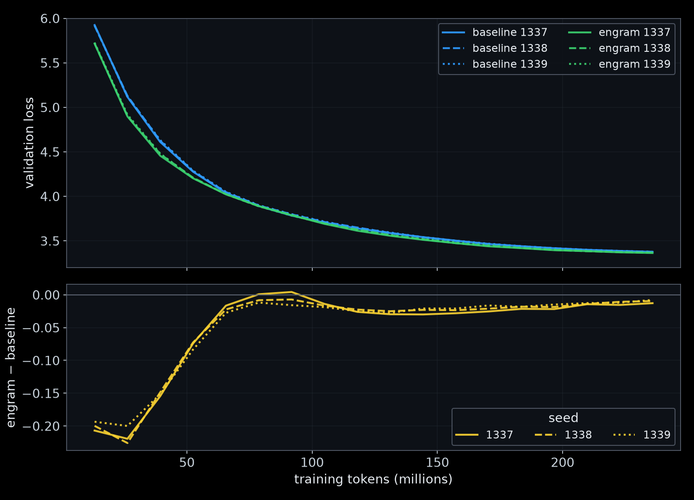
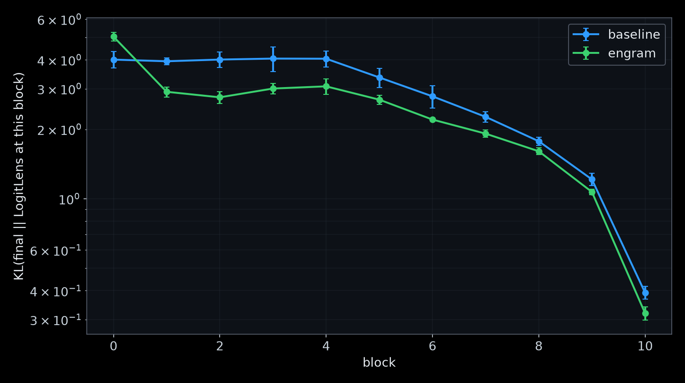

# Engram from scratch: a small GPT with and without Engram on WikiText-103

Trains a 12-block GPT on WikiText-103 twice, once with an [Engram](https://arxiv.org/abs/2601.07372) layer and once without, from the same initial backbone, data order and token budget, and evaluates both. The Engram here hashes exactly like the released DeepSeek-V4.1-Flash: its tests compare the token compression and every row id with the model's own `inference/engram.py`.

## Results

Three seeds per variant, 3,600 steps of 65,536 tokens, each run on one NVIDIA RTX PRO 4500 Blackwell. The 235.9M training tokens are about twice WikiText-103's 118.0M; windows are drawn at random with replacement, so this is not two exact passes. `results/summary.json` holds every value below, and the validation loss at every evaluation of every run; `scripts/summarize.py` rebuilds it from the run directory.

| | Engram | Baseline |
|---|---|---|
| Parameters | 132.0M (63.8M backbone, 67.2M table, 1.0M Engram projections and gate) | 63.8M |
| Validation perplexity, mean ± sd of 3 seeds | 28.97 ± 0.08 | 29.26 ± 0.01 |
| Test perplexity | 29.40 ± 0.16 | 29.36 ± 0.13 |
| Validation perplexity with Engram skipped | 59.54 | — |
| Training throughput | 149.5k tokens/s | 155.7k tokens/s |
| Gate before block 1: mean, and share of positions above 0.5 | 0.66, 0.74 | — |

On validation, the Engram model is 1.0% lower in perplexity, and lower for each of the three seeds. On test, the two are level: the Engram model is 0.06, 0.06 and 0.00 higher than the baseline of the same seed. At this scale the added table does not improve held-out perplexity in a way both splits agree on.



The Engram model learns much faster at first: at step 400 (26M tokens) its validation loss is 0.20 to 0.23 lower than the baseline of the same seed, and the baseline reaches that loss between steps 400 and 600, at about step 485 by linear interpolation between evaluations, which are 200 steps apart. The difference falls to about zero by 80M tokens, and from 100M tokens to the end it stays between −0.008 and −0.030, the same for all three seeds.



The trained Engram model depends on its lookup: skipping it doubles validation perplexity, from 28.97 to 59.54. Its intermediate predictions are also closer to its final one from the block where Engram is added onward: after block 1 the KL to the final distribution is 2.91 against 3.94 for the baseline, and the Engram model stays lower through block 10. After block 0, before Engram is added, it is higher (5.04 against 4.01). This is consistent with the paper's reading, that Engram takes over the early composition of local patterns so the backbone reaches a prediction-ready representation in fewer blocks, but it does not establish it: the KL measures how close each model is to its own final distribution, which shows where each model settles, not what Engram supplies or which model predicts better.

## The model

| Part | Here | Reference |
|---|---|---|
| Backbone | GPT-2 style decoder: 12 blocks, d = 512, 8 heads, 512-token context, GELU MLP, pre-LayerNorm, tied embeddings, 63.8M parameters | — |
| Token compression | The normalisation of `build_compressed_token_map`, applied to the GPT-2 tokenizer: 50,257 tokens become 32,962 compressed ids | DeepSeek-V4.1-Flash `inference/engram.py`, identical output (tested) |
| N-grams and hash | 2- and 3-grams, 8 heads each; XOR of `compressed_id × multiplier`, multipliers from a per-layer seeded generator, each (n, head) a prime-sized range of 65,537 to 65,651 rows | Same algorithm; identical row ids for the same configuration (tested) |
| Table | 16 ranges, 1,049,422 rows in all, × 64: 67.2M parameters | V4.1-Flash: 24 ranges of about 16M rows, 384,006,168 rows in all per layer, × 256 |
| Gate and update | `gate = sigmoid(signed_sqrt(<h, q·k·key> · rstd(h) · rstd(key) / √d))`, output `h + gate · value`, with `key, value = wkv(e_t)` | V4.1-Flash `Engram.forward` with one residual stream |
| Placement | Added to the residual stream before block 1 (the second block), before its attention | V4.1-Flash applies Engram before blocks 1 and 14; the paper finds the second block best for a single Engram layer |
| Not included | Hyper-connections (one residual stream instead of four copies) and the paper's short convolution, which V4.1-Flash also omits | — |

The two variants share every backbone weight at initialisation: Engram is constructed after the backbone is initialised, from its own random stream, so the same seed gives the same backbone (tested). Training draws the same batches in the same order for both.

## What the comparison is

The Engram model is the baseline plus Engram: 67.2M table parameters and 1.0M parameters for its projections and gate, 132.0M in total against 63.8M. It is therefore not a parameter-matched comparison. Reading 16 rows per token adds little computation; measured training throughput was 149.5k tokens/s with Engram and 155.7k without, 3.9% lower, on the same GPU type. The paper's own comparisons hold the total parameter count fixed by moving parameters out of MoE experts, which a dense GPT does not have.

Both variants use the same optimiser settings for the backbone (AdamW, peak learning rate 6e-4, cosine decay, weight decay 0.1). The Engram tables are trained with Adam at five times the learning rate and no weight decay, as in the paper. Gradients are clipped to norm 1.0 in three separate groups, the backbone, the Engram projections and the tables, so that Engram never changes how the backbone is clipped.

## Evaluation

| Measure | Definition |
|---|---|
| Perplexity | Over every full 512-token window of the split, each window starting without history (attention, positions and n-gram look-back reset), as in training. The tokens after the last full window are not scored; the output reports the coverage |
| Engram-off perplexity | The trained Engram model with its Engram layer skipped: how much the trained model relies on it |
| LogitLens KL | The residual stream after each block, projected through the final LayerNorm and output head, compared with the model's final distribution as KL(final ‖ block). Smaller means closer to the final prediction at that block |
| Gate statistics | The mean gate and the share of positions with a gate above 0.5 |

## Reproduce

The unit tests run on a CPU:

```bash
git clone https://github.com/littlemex/zenmai-lab.git
cd zenmai-lab/experiments/2026-10-21-engram-nanogpt
uv run --python 3.11 --with-requirements requirements.txt --with-requirements tests/requirements.txt python -m pytest tests
```

Training runs as one Kubernetes Job with two NVIDIA GPUs on a cluster such as one built with [distributed-ai](https://github.com/littlemex/distributed-ai)'s `infra/eks`: the Engram model on one, the baseline on the other, for each seed in `SEEDS`. The Job pulls the public `pytorch/pytorch:2.9.1-cuda12.8-cudnn9-runtime` image, installs its few dependencies at start-up, downloads WikiText-103 and the GPT-2 tokenizer from Hugging Face, and writes everything to a 50 GiB PersistentVolumeClaim on the cluster's default storage class. The code reaches the pod as a ConfigMap, so no image is built. Rendering needs `--load-restrictor LoadRestrictionsNone` because the ConfigMap is generated from files outside the kustomization directory.

```bash
export NAMESPACE=default
kubectl kustomize --load-restrictor LoadRestrictionsNone k8s/smoke | kubectl apply -n "$NAMESPACE" -f -
kubectl -n "$NAMESPACE" wait --for=condition=complete job/engram-lm-smoke --timeout=30m
kubectl kustomize --load-restrictor LoadRestrictionsNone k8s/base | kubectl apply -n "$NAMESPACE" -f -
kubectl -n "$NAMESPACE" wait --for=condition=complete job/engram-lm-train --timeout=4h
kubectl -n "$NAMESPACE" apply -f k8s/fetch-pod.yaml
kubectl -n "$NAMESPACE" wait --for=condition=ready pod/engram-lm-fetch --timeout=5m
mkdir -p runs
kubectl -n "$NAMESPACE" exec engram-lm-fetch -- tar cf - --exclude="*.pt" -C /work/runs wikitext103-3seeds | tar xf - -C runs
kubectl -n "$NAMESPACE" delete pod engram-lm-fetch
uv run --python 3.11 --with numpy --with matplotlib python scripts/summarize.py --run-dir runs/wikitext103-3seeds --out-dir results
```

The copy leaves out the checkpoints, about 4.7 GB for the six runs; `summarize.py` needs only the metrics and evaluations. A checkpoint can be copied the same way one file at a time when it is needed.

`k8s/smoke` trains 60 steps with one seed to check the setup end to end. Each run writes to `/work/runs/$RUN_NAME`, and an existing run directory is refused, so a second full run needs another `RUN_NAME` in `k8s/base/train-job.yaml`. The smoke run's `RUN_NAME` is `smoke-{pod}`, which becomes the pod's name, so it can be repeated. A finished Job must be deleted before the same Job name is applied again. A failed run is not resumed but rerun into a new directory.

## Layout

```
2026-10-21-engram-nanogpt/
├── engram_lm/
│   ├── tokenizer.py   GPT-2 tokenizer and the Engram token compression
│   ├── engram.py      table layout, n-gram hash and the Engram layer
│   ├── model.py       the GPT, with Engram layers when configured
│   ├── data.py        WikiText-103 to uint16 token files, training and evaluation windows
│   ├── train.py       training loop
│   └── evaluate.py    perplexity, Engram-off perplexity, LogitLens and gate statistics
├── configs/           engram.json and baseline.json, identical but for Engram
├── k8s/               the training Job, its smoke variant and a pod to copy results out
├── scripts/summarize.py
├── results/           summary.json and figures of the reported run
└── tests/
```
