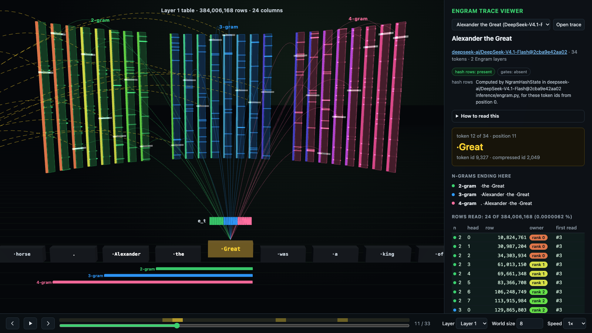
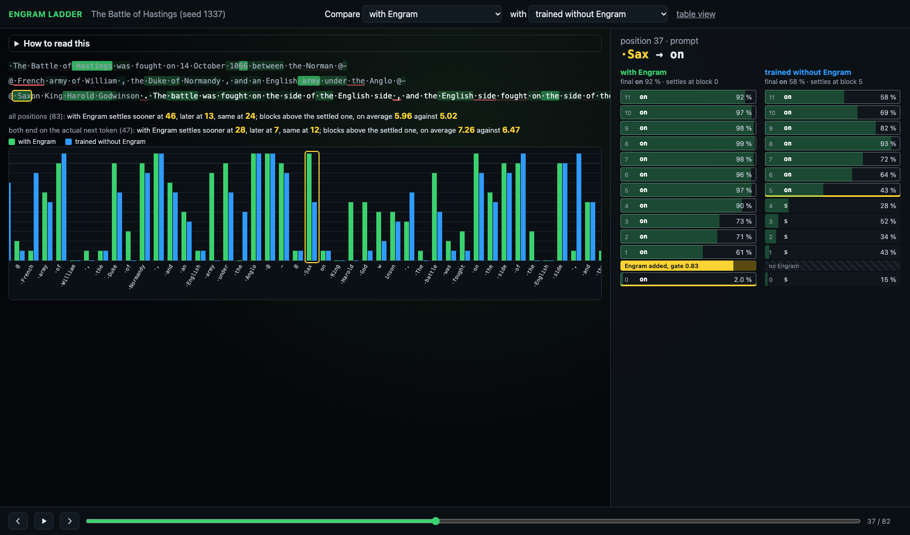

# Engram trace viewer

A static, backend-free 3D viewer for the n-gram lookups of [Engram](https://arxiv.org/abs/2601.07372), and a recorder that produces its input from the released DeepSeek-V4.1-Flash. For every token the viewer shows the n-grams that end there, the rows of the Engram table they hash to, which rank holds each row, and which earlier token read the same row first.

A second page, the ladder view, shows what a trained model does with those lookups: for every position of a text, the block from which its top-1 next-token prediction stops changing, compared between a model with Engram and one without.



## What is in a trace

The viewer only draws what a trace file contains, and the side panel says how each part was obtained. For the traces recorded here from DeepSeek-V4.1-Flash:

| Part | How it is obtained | In those traces |
|---|---|---|
| Tokens and compressed ids | The model's tokenizer and the compression map built by its `inference/engram.py` | recorded |
| Row ids, `hash_rows` | `NgramHashState` from the model's `inference/engram.py` at a pinned revision, called unchanged | recorded |
| Owner rank of a row | `row ÷ ⌈rows ÷ world size⌉`, the contiguous split of the reference `ParallelEngramEmbedding` and of the DeepEP Engram buffer. Computed in the browser for any world size | derived |
| Gate values, `gates` | Need the hidden state entering the Engram layer, so only a run of the full model can produce them | not recorded |

The row ids do not depend on the model weights: the hash uses only the token ids, the tokenizer and the configuration. A trace therefore holds the rows the released model reads when exactly these token ids are fed from position 0, with no earlier context. A chat prompt adds a BOS token and template tokens before the text, which changes the n-grams of the first few positions; `--add-bos` records the BOS case.

`traces/nanogpt-hastings.json` comes from the small trained models of [`2026-10-21-engram-nanogpt`](../2026-10-21-engram-nanogpt/) instead: its row ids are computed by that model's own hash, which its tests check against the reference, and its gates and `lens` are recorded from full forward passes of the trained models.

## View the bundled traces

ES modules do not load from `file://`, so serve the `viewer` directory over HTTP.

```bash
git clone https://github.com/littlemex/zenmai-lab.git
cd zenmai-lab/experiments/2026-10-21-engram-trace-viewer/viewer
python3 -m http.server 8000
```

Open <http://localhost:8000/>. The server keeps this terminal; run the commands of the next sections in a second terminal, starting in the directory where you ran `git clone`. The picker lists the traces in `viewer/traces/index.json`. Space plays and pauses, the arrow keys step, and for a bundled or remote trace the URL keeps the trace, position, layer and world size, so the view can be shared as a link. A trace opened from a local file cannot be shared that way, and its URL keeps only the world size.

| On screen | Meaning |
|---|---|
| Tiles in front | Tokens. Faint `pad` tiles stand for the padding the model hashes before the first token |
| Coloured bars under the tiles | The 2-, 3- and 4-gram that end at the current token |
| Wall of columns | The Engram table of one layer. Each column is the row range of one (n-gram size, hash head) pair, first row at the bottom |
| Marks on a column | Rows read by the positions up to the current one. Overlapping marks glow brighter; one mark spans about a hundred thousand rows, so the table in the side panel and the dashed arcs are what show exact reuse |
| Solid lines | The current token's rows. Dashed yellow arcs join a row to the earlier token that read it first |
| Strip on a column's left edge | The rank that holds those rows at the chosen world size |
| `e_t` | The rows joined into one vector, coloured by n-gram size |
| Strip above the timeline | For each position, the share of its rows that an earlier position already read |

## The ladder view

`ladder.html` opens a trace that carries a `lens` field. The bundled `traces/nanogpt-hastings.json` is written by [`engram_lm.record_trace`](../2026-10-21-engram-nanogpt/engram_lm/record_trace.py) from the small models trained in [`2026-10-21-engram-nanogpt`](../2026-10-21-engram-nanogpt/): a prompt about the Battle of Hastings continued greedily by the Engram model, then read by three variants of the same seed, the Engram model, the same weights with the Engram layer skipped, and the model trained without Engram.



With the server of the previous section running, open <http://localhost:8000/ladder.html>.

| On screen | Meaning |
|---|---|
| Text | Grey tokens are the prompt, white ones were generated. A token is shaded green where the first picked model settles at an earlier block than the second, and underlined red where later. The last token has no next token and is not compared |
| Summary | How many positions settle sooner, later and at the same block, and the mean number of blocks above the settled one; once over every position, and once over the positions where both models end on the token that actually comes next |
| Bars | Blocks above the settled one, per position and per model |
| Ladder | For the selected position, each block's top-1 token and its probability, block 0 at the bottom, with a bar for the probability the block gives the final answer. The settled block is underlined in yellow; the band below block 1 is where the Engram output is added, with its gate |

Each block's prediction is its residual stream passed through the model's final LayerNorm and output head (LogitLens). A prediction settles at the first block from which the top-1 token equals the last block's top-1 token and stays equal up to the last block. The blocks above the settled one still run and still change the probabilities; settling says only that their top-1 no longer changes, and a position can settle on a guess its block gives little probability. The counts describe one text and one seed, and the 40 generated tokens are the Engram model's own continuation, which favours it; [`engram_lm.settling`](../2026-10-21-engram-nanogpt/engram_lm/settling.py) counts the same quantity over the 483 full windows of the validation split for all three seeds. The pickers choose the two models compared, Space plays through the text, and the URL keeps the position and the two models.

## Record a trace

The recorder downloads only small files from the model repository: `inference/config.json`, `inference/engram.py`, `tokenizer.json` and `tokenizer_config.json`. It runs on a CPU in seconds.

```bash
cd zenmai-lab/experiments/2026-10-21-engram-trace-viewer
uv run --python 3.11 --with-requirements recorder/requirements.txt python recorder/record_trace.py --text "The cat sat on the mat. The cat sat down." --title "The cat" --out viewer/traces/the-cat.json
```

Then open <http://localhost:8000/?trace=traces/the-cat.json>, or drop the file onto the page. `--text-file` reads the text from a file, `--add-bos` prepends the BOS token as a chat prompt starts, and `--revision` selects another commit, branch or tag of the model repository. The trace records the commit it resolved to and the SHA-256 of every file it used. The recorder executes `inference/engram.py` from that commit, so pin `--revision` to a commit you trust.

## Host it

The `viewer` directory is the whole application: HTML, CSS, ES modules and a vendored copy of three.js. Copy it to any static host (GitHub Pages, an S3 bucket, a CDN). `?trace=<url>` loads a trace from another origin when that origin allows it with CORS.

## Trace format

A trace is one JSON file, `engram-trace` version 1, defined by [`viewer/schema/engram-trace.schema.json`](viewer/schema/engram-trace.schema.json).

| Field | Shape |
|---|---|
| `layers[l].columns[c]` | `{n, head, offset, size}`: the row range of column `c` in layer `l`'s table. Ranges are contiguous and cover `num_rows` |
| `tokens[t]` | `{id, text, compressed_id, display?}`. `display` labels a token that holds part of a character, such as `庁 1/2` |
| `hash_rows[t][l][c]` | The row read at position `t`, layer `l`, column `c`, counted from the start of the layer's table |
| `gates[t][l][k]` | Optional. The gate value of hc copy `k`; the viewer draws it next to `e_t` and lists it in the side panel when present |
| `generation` | Optional. `{prompt_tokens, new_tokens, by, method}`: the first `prompt_tokens` tokens were given and the rest generated |
| `lens.values[v][t][b]` | Optional, needed by the ladder view. For variant `v`, position `t` and block `b`: `top`, the top-k `[id, probability]`; `p_final`, the probability of the variant's own final top-1 token; `p_next`, the probability of the actual next token (`null` at the last position); `kl`, KL(final ‖ block) in nats |
| `lens.variants[i]` | `{name, label, engram, checkpoint_step}`. `engram` is `added`, `skipped` or `absent`: what the variant does where Engram is added. `gates` belong to the `added` variant |
| `lens.vocab`, `lens.engram_before_block` | The text of every id in a top list, and the blocks the Engram output is added in front of |
| `source`, `provenance` | The model repository and revision, the hash of each file used, and one sentence per field on how it was obtained |

Beyond the schema, the viewer checks that each layer has the columns (n, head) for n = 2 to `max_ngram_size` and head = 0 to `n_heads - 1` in that order, that they tile the table, that every row is an integer inside its column, and that gates, when present, hold one value in [0, 1] per position, layer and hc copy. It reports the first violation instead of drawing a wrong picture. Any producer that writes this format works with the viewer; `viewer/js/trace.js` holds the loading and indexing and has no DOM or three.js dependency.

## Tests

```bash
cd zenmai-lab/experiments/2026-10-21-engram-trace-viewer
uv run --python 3.11 --with-requirements recorder/requirements.txt --with-requirements tests/requirements.txt python -m playwright install chromium
uv run --python 3.11 --with-requirements recorder/requirements.txt --with-requirements tests/requirements.txt python -m pytest tests
```

`tests/test_recorder.py` rebuilds the table layout (the prime-sized ranges in (n, head) order) and the hash multipliers from the configuration with its own code, recomputes every row id from them and the trace's compressed ids, validates the trace against the schema, and checks that the same n-gram reads the same rows whatever its case. It does not re-derive the tokenizer's compression map, which it takes from the trace. `tests/test_viewer.py` serves the `viewer` directory over HTTP, opens it in headless Chromium, and compares the rows, owners, first-read positions and gate values on the page with the trace; it also checks that a copied URL restores the view, that out-of-range URL values fall back to a valid view, and that a malformed trace is refused with the reason. For the ladder view it recomputes both summary lines from the trace, checks the settled block against hand-made cases including a top-1 that matches, changes and comes back, compares the word and probability of every rung of one position and its gate with the trace, and checks the URL, the step controls, and the refusal of a trace without `lens` or with a malformed one.

## Layout

```
2026-10-21-engram-trace-viewer/
├── recorder/
│   ├── record_trace.py      writes a trace from the model's own inference/engram.py
│   └── requirements.txt
├── viewer/                  the static application
│   ├── index.html           the table and 3D view
│   ├── ladder.html          the ladder view
│   ├── css/                 style.css, ladder.css
│   ├── js/trace.js          loading, checks and indexing (no DOM, no three.js)
│   ├── js/colors.js         colours shared by the scene and the panel
│   ├── js/scene.js          the three.js scene
│   ├── js/panel.js          the side panel
│   ├── js/main.js           wiring, controls and the shareable URL
│   ├── js/ladder.js         the ladder view
│   ├── schema/engram-trace.schema.json
│   ├── traces/              bundled traces and index.json
│   └── vendor/three/        three.js 0.186.1 (MIT)
├── tests/
└── docs/                  viewer.png, ladder.png
```

## License

The viewer, recorder and tests are under the Apache License 2.0 in the repository's [LICENSE](../../LICENSE). `viewer/vendor/three` is three.js 0.186.1 under the MIT license, kept unmodified with its `LICENSE` file.
